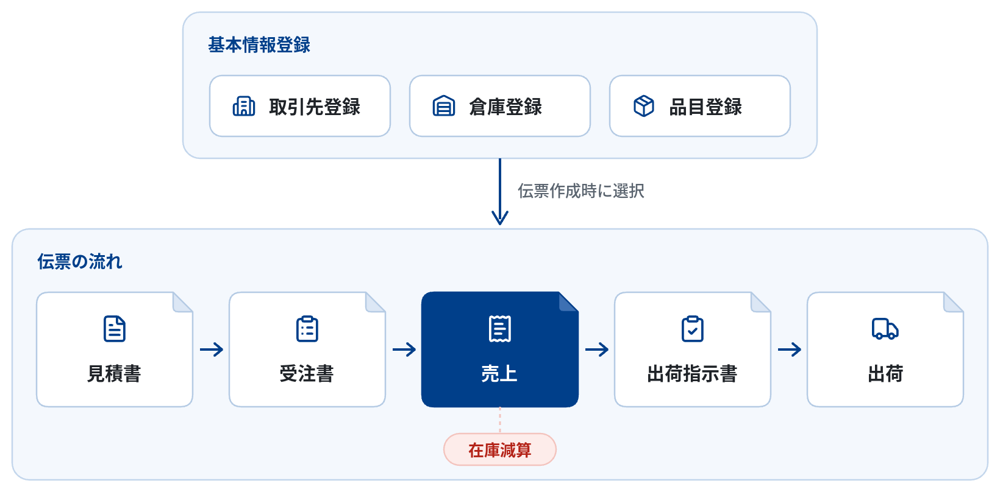
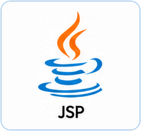
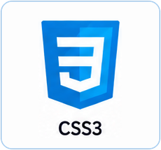
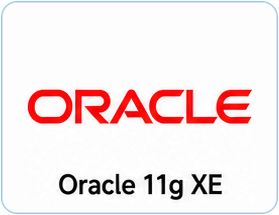
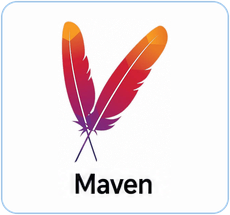
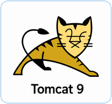
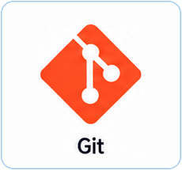

<p align="center">
  <picture>
    <source media="(prefers-color-scheme: dark)" srcset="docs/images/logo-dark.png">
    
  </picture>
</p>

<br>

## プロジェクト概要

Spring MVCを基盤とした売上・在庫管理ERPのチーム開発プロジェクトです。
マスター登録、見積、受注、売上、出荷指示、出荷、在庫の各業務を扱います。

### 業務の流れ

<p align="center">
  
</p>

<br>

## 技術スタック

| 区分 | 技術 |
| --- | --- |
| バックエンド |     |
| 画面 |       |
| DB |  |
| 開発・デプロイ |      |

<details>
<summary>バージョン情報</summary>
<br>

| 区分 | 技術 |
| --- | --- |
| バックエンド | Java 8, Spring MVC 5.0.7, MyBatis 3.4.6, HikariCP 2.7.4 |
| 画面 | JSP / JSTL, jQuery 3.7.1 |
| DB | Oracle 11g XE |
| 開発・デプロイ | Maven WAR, Tomcat 9, Eclipse / STS, Git / GitHub |

</details>

<br>

## ブランチ規約

```
main: リリース版
dev: 開発統合ブランチ（次回リリースの準備）
feature/機能名: 機能開発（例: feature/partner）
```

<br>

## 機能別ブランチ

| 機能 | ブランチ |
| ----------- | ------------------------------- |
| 取引先登録 | `feature/partner` |
| 倉庫登録 | `feature/warehouse` |
| 品目登録 | `feature/item` |
| 見積入力 | `feature/quotation-input` |
| 見積一覧 | `feature/quotation-list` |
| 見積集計 | `feature/quotation-status` |
| 未受注一覧 | `feature/quotation-unordered` |
| 受注入力 | `feature/salesorder-input` |
| 受注一覧 | `feature/salesorder-list` |
| 受注集計 | `feature/salesorder-status` |
| 未売上一覧 | `feature/salesorder-unsold` |
| 売上入力 | `feature/sale-input` |
| 売上一覧 | `feature/sale-list` |
| 売上集計 | `feature/sale-status` |
| 売上単価一括変更 | `feature/sale-bulk-price` |
| 出荷指示入力 | `feature/shipinstruction-input` |
| 出荷指示一覧 | `feature/shipinstruction-list` |
| 出荷入力 | `feature/shipment-input` |
| 出荷一覧 | `feature/shipment-list` |

<br>

## 機能開発の始め方

1. `dev`ブランチに切り替えます。
2. `dev`ブランチをPullして最新の状態にします。
3. `dev`から自分の`feature/機能名`ブランチを作成します。
4. 機能開発後にCommit・Pushします。
5. GitHubで`feature/機能名 → dev`のPull Requestを作成します。
6. Merge後、次の機能は最新の`dev`から新しいブランチを作成して開発します。

<br>

## PR規約

PRのタイトルはCommitメッセージと同じ`type: subject`形式で記入します。

例

```text
feat: 見積入力機能を実装
fix: 売上単価計算の不具合を修正
```
<br>

## Commit規約

```
type: subject

body（任意）
```

例

```
feat: 見積入力画面を実装

- 見積書の保存機能を追加
- 品目選択時に単価を自動入力
```

<br>

### type

| type | 用途 |
| --- | --- |
| feat | 機能の追加 |
| fix | 不具合の修正 |
| refactor | 動作を変えずにコードを整理 |
| style | 空白・インデントなど書式のみの変更 |
| docs | READMEなどのドキュメントの修正 |
| chore | 設定・ライブラリーの追加などその他の作業 |

* 複数の変更が含まれる場合は、最も重要なtypeを1つだけ選びます。

### subject

* 変更内容を簡潔に記入します。
* 末尾に句点を付けません。

### body（任意）

* 必要な場合のみ記入し、各行を`-`で始めます。
